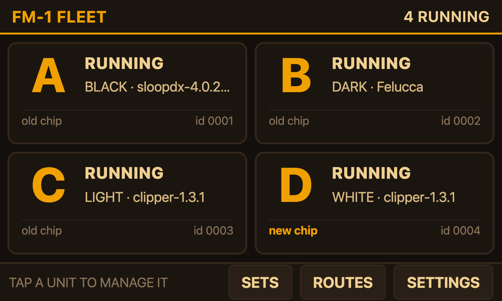
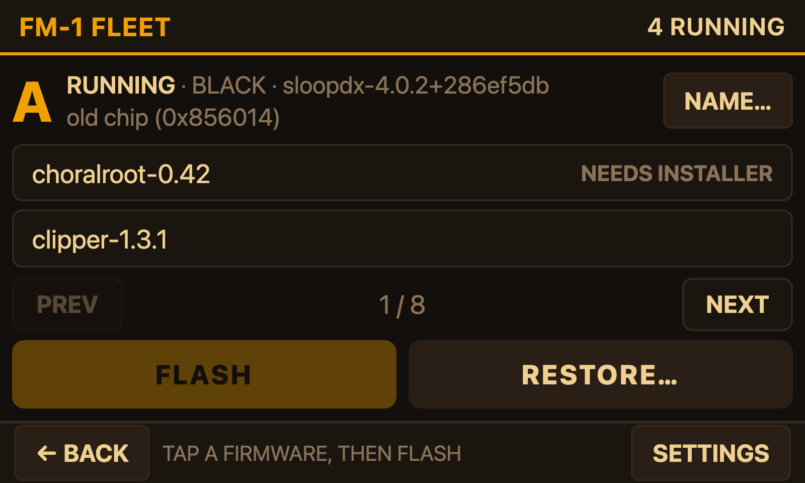
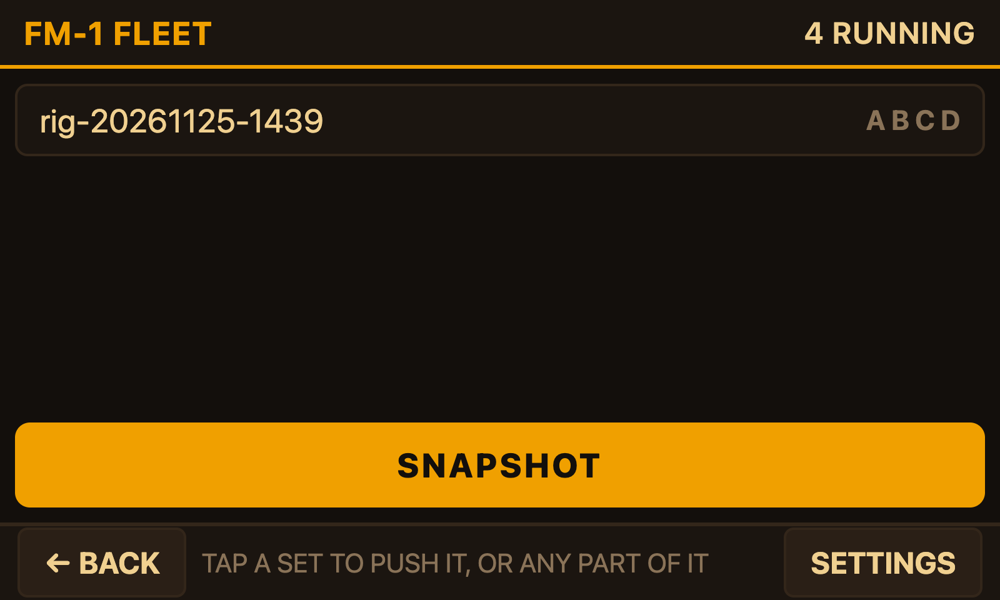
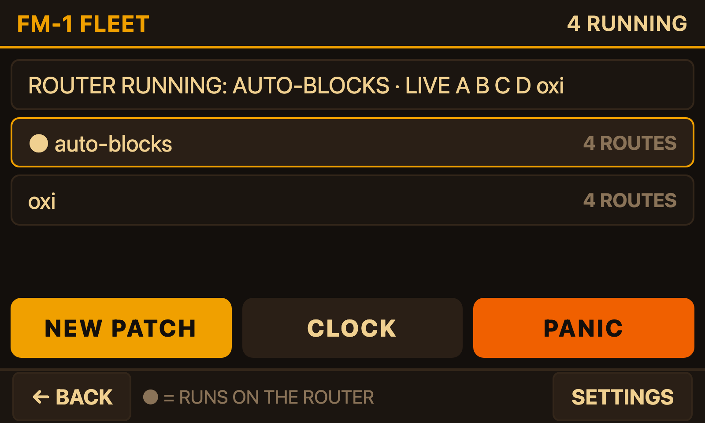
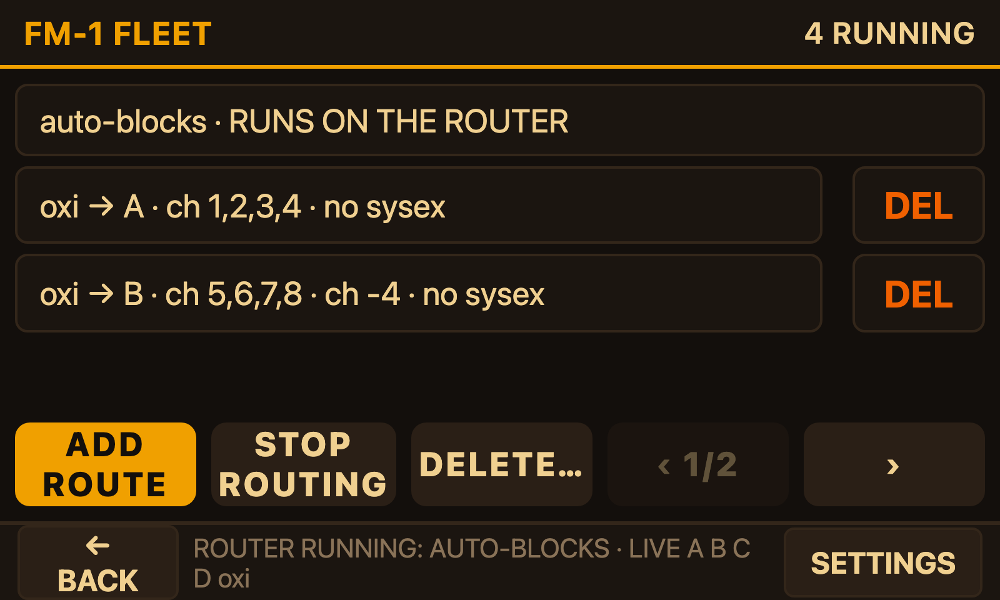
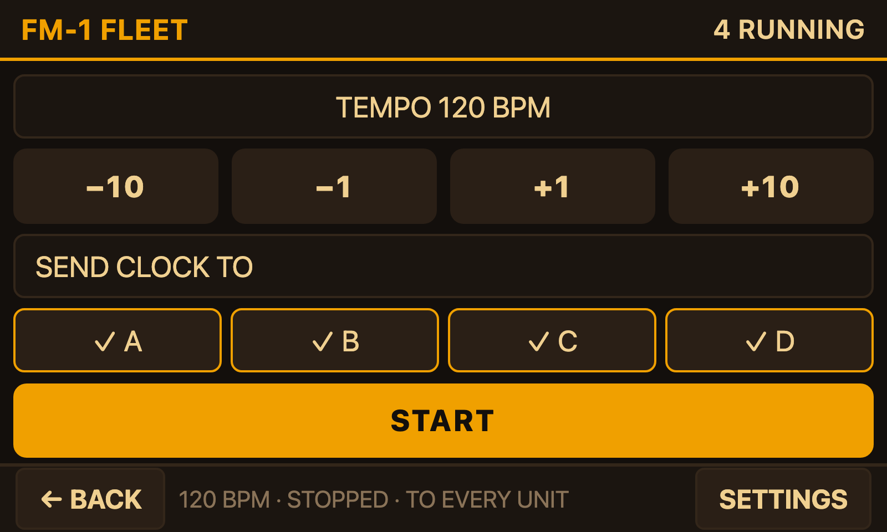
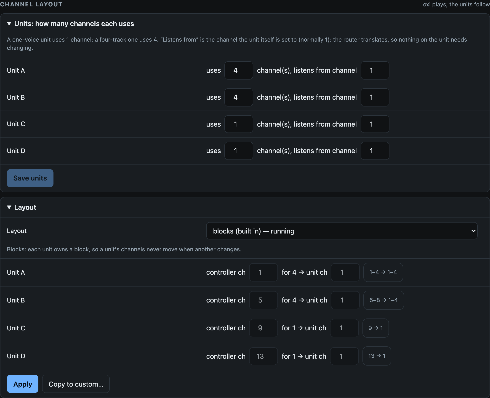
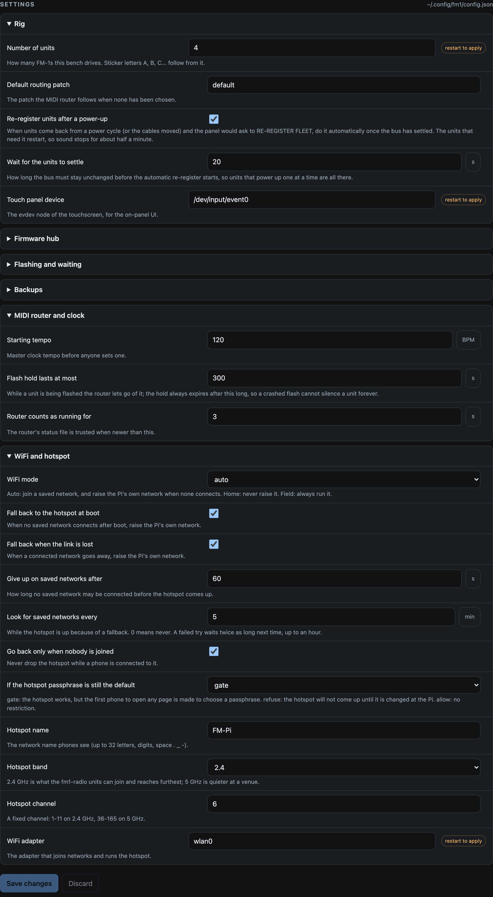
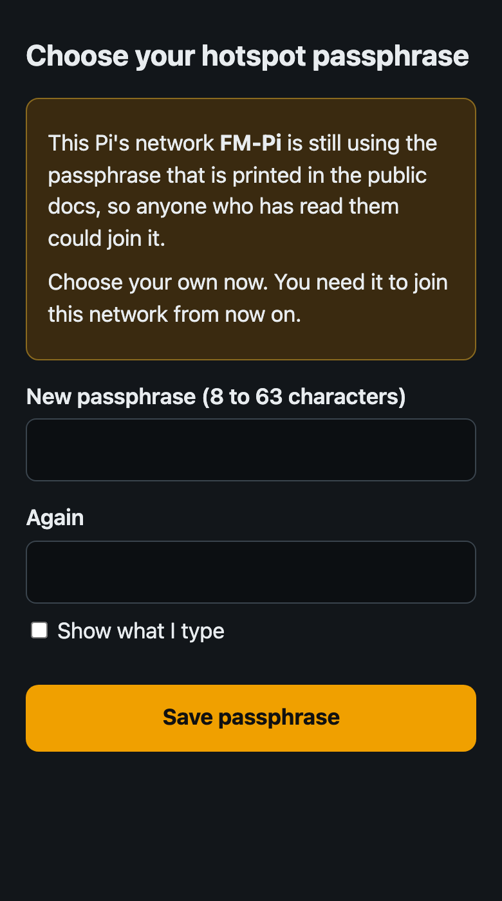
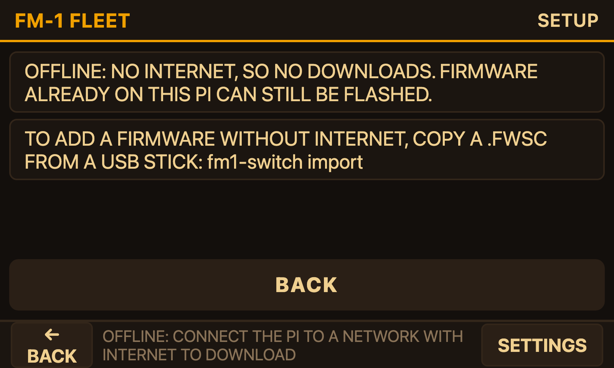

# FM-1 Fleet Manager

A Raspberry Pi that swaps firmware on a bench of **M-VAVE FM-1** synthesizers, and can also act
as their USB MIDI hub, routing MIDI and running a master clock between the units. **No screen
needed:** the Pi can run headless, with nothing attached but power, USB and network, and you drive
the same touch UI from a phone or tablet on your network (see *Headless* below). A small HDMI
touch panel is optional, if you would rather have one on the bench. You don't need a keyboard,
and the Pi never guesses which unit is which.

### Screenshots

The touch UI at 800x480, the size of the optional 5-inch panel (the same pages are served to a phone, which is all you
need), and the admin page, captured live from a real bench. Unit ids are shown as `0001` to `0004`, not the real ones. A
tour of every screen is in [`docs/GUIDE-screens.md`](docs/GUIDE-screens.md).

| Fleet | One unit |
|---|---|
|  |  |

| Rig sets | Routes |
|---|---|
|  |  |

| A patch | Master clock |
|---|---|
|  |  |

The admin page (`/index.html`): channel layouts, which map a controller's channels onto each unit so nothing on the units
needs setting, and the settings, including the WiFi hotspot.

| Channel layout | Settings |
|---|---|
|  |  |

Away from home, on the Pi's own WiFi hotspot: the form a phone sees first, and what the Pi shows with no internet.

| First-use passphrase form | GET FIRMWARE offline |
|---|---|
|  |  |

A `~` after a unit's letter means it was matched by USB port, not by a readable id (see
[how it works](#how-it-works)).

### Photos (owner to supply)

No photos are in the repository yet. They have to come from the bench, not from a
generator, so the places they belong are marked below. Save each file under
`docs/images/` with the name shown, then uncomment its line.

| File | What to photograph |
|---|---|
| `docs/images/bench-overview.jpg` | the Pi, the 5-inch panel and the four FM-1s together, as they sit on the bench |
| `docs/images/write-confirm.png` | a WRITE confirmation on the panel, with the unit and the package named |
| `docs/images/backup-chooser.png` | a backup row's DEL, opening the RESTORE / DELETE chooser |

<!--  -->
<!--  -->
<!--  -->

Do not add stand-in or generated images. A real photo of the bench is what this section is for.

Not affiliated with M-VAVE. "FM-1" is used only to say which hardware this is for.

---

## Why it exists

Several FM-1s plugged into one USB hub look the same to the host while they run. Three of
our four present as `1209:0001`, one as `4d4a:4155`, and none reports a USB serial number.
So "flash the one on the left" has no reliable meaning in software.

The one durable identity is the **factory id in each unit's flash chip**. It can only be read
while the unit is in download mode. This project is built around that fact:

* every unit is labelled by its flash id, never by USB port or order;
* every write goes to the device whose flash id was **just read** and matched;
* a label that is only a hint (from the running unit's `bcdDevice`) never authorises a write.

## Status — read this before installing

This is a working bench tool, used on one bench (Pi 3B+, Debian trixie, Waveshare 5"
800×480 resistive HDMI panel, four FM-1s). It is **not yet ready for general use**. The
audit in [`docs/AUDIT-fleet-manager.md`](docs/AUDIT-fleet-manager.md) lists what blocks
that. The ones you would notice:

| | |
|---|---|
| ✅ proven on hardware | flash by flash id from the panel; automatic backup before every write; restore from a backup; restart a unit left in download mode; re-learning a unit's fingerprint after a flash; **putting every letter back on the right unit after the cables move** (RE-REGISTER FLEET, 2026-11-27); an Oxi One driving four units through the router with channel layouts (by ear, 2026-11-27); **an UPDATE badge appearing for a unit and the update flashed from the panel** (sloopDX 4.0.1 to 4.0.2 on unit A, with the automatic backup taken first, 2026-11-28); **the Pi's own WiFi hotspot taking over when the WiFi is lost, a phone joining it and never being dropped, the Pi returning when the phone leaves, and the first-use passphrase form** (2026-11-28) |
| 🧪 tested with fakes only | registering a new unit — reading its flash id in download mode and binding it to a sticker, from the panel (FEAT-01); visible failure explanations, BACK UP NOW / delete backup, unit names, GET FIRMWARE, flash SEVERAL units |
| ⚠️ known problems | the panel's held-press and modal-overlap fixes (audit UX-01/02) are code-tested, not yet re-proven on the panel — **do the stylus-hold check before trusting it**; the unguarded CLI `install` write path was removed (SAFE-01) — the panel is the only writer |

## How it works

```
 panel (cog kiosk) ──► http://127.0.0.1:8080/fleet ─┐
 phone/laptop      ──► http://<pi>:8080/          ─┤   fm1-switch (Python stdlib only)
                                                    │     guided.flash:
                                                    │       soft key → wait → read every
                                                    │       download-mode unit's flash id →
                                                    │       back up the match → write it →
                                                    │       restart → re-learn
                                                    ▼
                                         m-flasher (subprocess) ──► FM-1s over USB
```

* `fm1-switch/` is the product: a web server, a JSON API, the panel UI (`/fleet`) and a denser
  expert UI (`/`). It has no dependencies beyond the Python standard library and no build step.
* Every write goes through [m-flasher](https://github.com/jvitkauskas/m-flasher), run as a
  separate program.
* The earlier `fleetctl` package — port-addressed writes, the audit's finding FC-01 — was
  **removed**. Its udev rule lives on at `fm1-switch/udev/` (installed by `setup.sh`): the
  fleet screen still reads its port symlinks on a mapped bench (audit ARCH-02), and its
  permission lines let m-flasher reach units without root. Writes by port name are gone.

### After you move the cables

A letter (A, B, C, ...) belongs to a unit's flash id, not to a USB port, so moving a unit to another
hub port, swapping a hub, or replugging everything never changes which letter is which. What goes
stale are the saved ports and the running fingerprints the panel uses to recognise a unit without
opening it, and units that look alike while running cannot be told apart from USB. You will see a
letter say **NOT CONNECTED** while the same units show as **?**, or a letter drawn with a `~`
(placed by port only). The panel then shows **FLEET NOT REGISTERED** above the unit grid, with a
**RE-REGISTER FLEET** button.

It puts the unmatched units into download mode, reads each flash id, matches it to its letter **by
id**, restarts them and re-learns their ports. It **never writes flash and never gives a new
letter** (a unit nobody owns is reported, and REGISTER stays deliberate). Sound stops for about half
a minute while the units restart. After a plain power cycle it runs by itself once the units have
settled (a setting turns that off). Full walk-through, the messages and what to do about each:
[`docs/GUIDE-registering-units.md`](docs/GUIDE-registering-units.md).

### Away from home: the Pi's own WiFi

At a gig or a rehearsal there is no known WiFi. With the fallback on, **when the Pi cannot connect to any saved network
it makes its own** (`FM-Pi`), you join it from a phone, and the same UI opens at `http://fm-pi.local/`. When your WiFi
is back and nobody is on the hotspot, the Pi goes back to it by itself. It never creates, changes or deletes a saved
network.

The hotspot starts with a **published default passphrase**, so the Pi makes you replace it: the first phone to open any
page on the hotspot is taken to a form that asks you to choose your own, and can reach nothing else until it does. Better
still, choose it once at home. To set it up (details, options and troubleshooting in
[`docs/GUIDE-wifi-hotspot.md`](docs/GUIDE-wifi-hotspot.md)):

```bash
sudo cp ~/fm1/fm1-switch/polkit/50-fm1-wifi.rules /etc/polkit-1/rules.d/ && sudo systemctl restart polkit   # once
fm1-switch net setup                       # makes the hotspot profile; offers to choose your passphrase
fm1-switch net passphrase --prompt         # or choose it here
cp ~/fm1/fm1-switch/systemd/fm1-net.service ~/.config/systemd/user/ && systemctl --user enable --now fm1-net
```

**Without internet**, things that need the Firmware Hub say so at once instead of hanging: the saved catalogue is shown
marked offline, downloads are refused with an explanation, and firmware already on the Pi can still be flashed (to add
one, copy a `.fwsc` from a USB stick with `fm1-switch import`). Verified on a real Pi: the fallback from the service, a
joined phone never dropped, the return, and the first-use form; a bench test you can run yourself is in
[`docs/BENCH-wifi-fallback.md`](docs/BENCH-wifi-fallback.md).

The Pi has **no battery clock**, so a Pi switched off and started offline believes it is still the moment it shut down.
It knows when its clock cannot be trusted, marks audit-log lines written then (`"clock": "unsynced"`), and a phone can
set it: when the clock is untrusted and the phone's time differs, the touch screen offers **SET FROM THIS PHONE**
(`fm1-switch time status|set` does the same from a shell). See
[The clock](docs/GUIDE-wifi-hotspot.md#the-clock-with-no-internet).

## The safety model, in eight lines

1. Never guess which unit. An unknown unit is shown as `?` with its id.
2. A write takes two deliberate actions, and the second names the unit.
3. Write only to a unit that is in download mode.
4. Match writes by flash id. If nothing matches, write nothing.
5. Back up the unit first. If the backup fails, write nothing.
6. One write at a time. A second request is refused, not queued.
7. The server re-checks what you confirmed: the unit id, the package checksum, the backup's path.
8. Log every request and its result to `~/fm1-flash.log`.

[`docs/AUDIT-fleet-manager.md`](docs/AUDIT-fleet-manager.md) §4 shows where each rule is
enforced and where it currently is not.

**What it will never do:** pick a unit for you, write without a confirmation that names the
unit, or write without taking a backup first.

**What the router does, and does not do:** the optional MIDI router (see the install notes)
connects the units' USB MIDI ports, and a USB controller such as an **Oxi One**, through the Pi, with
saved patches, per-route channel remap, shift and filters, a master clock, and a PANIC button. **Channel
layouts** hand each unit a slice of the controller's 16 channels (A 1-4, B 5-8, a one-voice unit 1, ...)
and translate it onto the channels the unit listens on, so nothing on the units needs setting, up to
sixteen one-channel units. It never touches a unit's flash and lets go of every unit before a flash.
Verified on the bench: all four units attach, a live route from one unit to another, the soft key
while the router holds the units, and an Oxi One driving four units. The clock is tested against a
fake sequencer only; round-trip latency to a unit is not measured. Under-voltage was seen with four
units on the Pi's own ports, so use a powered hub. The guide is
[`docs/GUIDE-midi-hub.md`](docs/GUIDE-midi-hub.md); the status and ideas are in
[`docs/ROADMAP-dawless-hub.md`](docs/ROADMAP-dawless-hub.md).

## Install (current, bench-specific)

Every step below assumes the original bench. Each assumption is listed so you can tell what
to change.

1. **OS.** Raspberry Pi OS Lite **64-bit** (aarch64). Tested on a Pi 3B+ running Debian trixie.
2. **m-flasher.** Install the ARM64 `.deb` from its releases page, or put the binary at
   `~/bin/m-flasher` (or set `FM1_FLASHER`).
3. **Clone and bake.**
   ```bash
   git clone <this repo> ~/fm1 && cd ~/fm1
   sudo ./setup.sh            # or: sudo MFLASHER_DEB=/path/to/m-flasher_<ver>_arm64.deb ./setup.sh
   ```
   *Assumptions:* `setup.sh` installs one package (fm1-switch) and the udev rule at
   `fm1-switch/udev/80-fm1.rules`, whose port paths (`KERNELS=="1-1.1.2"` …) were measured on
   our hub, so **edit them for yours**: `udevadm info -a -p /sys/bus/usb/devices/<port>`. The
   fleet screen currently finds download-mode units only through these symlinks (audit
   ARCH-02), and the rule's permission lines let m-flasher reach the units without root.
   The kiosk unit needs `curl`: `sudo apt install curl`.
4. **Services.** Copy `fm1-switch/systemd/fm1-web.service` to `~/.config/systemd/user/`
   (then `loginctl enable-linger $USER`) and `fm1-kiosk.service` to `/etc/systemd/system/`.
   *Assumptions:* `fm1-web.service` uses `%h`, so it works as-is when the repo is cloned to
   `~/fm1`; elsewhere run `systemctl --user edit fm1-web`. `fm1-kiosk.service` is a system
   unit and still carries `YOUR-USER` (3 lines: `User=`, `Group=`, `WorkingDirectory=`).
   `m-flasher` is found on `PATH`; otherwise set `flasher` in the config file below.
   **Optional: the MIDI router** (dawless hub). `fm1-switch/systemd/fm1-router.service` is also a
   user unit: copy it to `~/.config/systemd/user/` and run `systemctl --user enable --now
   fm1-router`. It routes the patch named `default` (`fm1-switch route add default fm1-a fm1-b`),
   idles when there is none, follows edits to the patch file, and lets go of every unit before a
   soft key. The touch UI's ROUTES page edits patches, chooses which one runs, and has PANIC. See `docs/ROADMAP-dawless-hub.md`.

   **Config (optional).** `~/.config/fm1/config.json` — every key optional:
   `{"units": 4, "library": "~/fm1-firmwares", "backups": "~/fm1-backups",
   "registry": "~/fm1-units.json", "portmap": "~/fm1-portmap.txt", "flasher": "/path/to/m-flasher"}`.
   `units` is 1–8 (stickers A–H; the panel grid widens above 4). The `FM1_*` environment
   variables still win over the file. Restart `fm1-web` after changing it.
   **Settings page.** Nearly everything else that used to be a constant (timeouts, how long the
   catalogue stays fresh, how many automatic backups are kept, the starting tempo, how long a
   flash hold lasts, every data folder and file) is edited from the **Settings** section at
   the bottom of the web admin (`http://<pi>:8080/index.html`, or `/index.html` headless). It writes
   the same file; changes apply on the next use, except the few marked "restart to apply". Every
   change leaves a line in the audit log. Deliberately **not** editable from the website, only
   in the file or environment: the `m-flasher` program, the maker's installer folder and the
   hub address (they decide what code runs and where firmware comes from), and the bind address,
   port, write token and allowed host names (they decide who may write to the units). The
   schema is one list in `fm1-switch/fm1_switch/config.py`; adding a setting there adds it to the page.
   **Headless (no panel, no screen).** On a Pi Zero 2 W or any small board, skip the kiosk and the panel
   steps below. Install `fm1-switch/systemd/fm1-web-headless.service` to `/etc/systemd/system/`
   (edit `YOUR-USER`), enable it, and open `http://<pi-address>/` on a phone or tablet
   on the same network. It is the same screen as the 5-inch panel, sized for a phone held
   sideways. The first write asks for the Pi's write token (`~/.config/fm1/token`, also
   printed in the journal); the phone remembers it. Wrong guesses lock that address out for
   five minutes. **LAN only:** the page is plain HTTP, so anyone on your network can read
   the token as you type it. Do not forward port 80 to the internet. `fm1-switch web
   --headless` is the same thing run by hand (`--port` to change from 80).
5. **Panel.** The panel we used sends no EDID. `fm1-switch/tools/make-edid.py` builds one for
   *that* panel's 800×480 timing. Other panels need their own timing. Touch calibration is
   per panel (`fm1-switch/tools/calibrate-touch.sh`).
6. **Register your units (from the panel).** SETTINGS → REGISTER, or — when the Pi has
   seen nothing at all yet — the REGISTER A UNIT button on the empty fleet screen. Put
   the new unit into download mode (with only that one unit connected,
   `m-flasher download-mode` puts it there; a unit can also be left there by a failed
   boot), then, on the panel:

   * the scan lists every unit it can see in download mode, with the flash id **the
     server itself has just read**, and marks the ones that already wear a sticker;
   * tap the unregistered one: the confirmation names its full flash id **and** the
     letter it will get. Press REGISTER (the press that opened the dialog cannot
     confirm it — the same guarded confirm every write uses);
   * the binding is written to `~/fm1-units.json`. That is all registering does: it
     records metadata — which physical unit wears which letter — and touches no unit.
     Name it from its own unit screen (NAME…) afterwards.

   There is no panel button that sends the download-mode soft key yet: it has
   been seen to move every MIDI-capable unit at once (and, in other runs, only the one
   addressed), and registering refuses
   while more than one unregistered unit is in download mode. Get ONE unit there by
   the means above, or restart the extras (RESTART UNIT on a flash-id unit page).

   The flow refuses, with the reason on screen: no unit in download mode; more than one
   unregistered unit (leave only one connected and scan again); the unit is already
   registered (use rename for its name — moving a binding to another letter is not
   built yet); every letter A–D already taken. If the unit leaves download mode between
   the scan and the confirm, the bind re-reads the bus and refuses: **a binding is only
   ever created from a flash id the server read from the device, in download mode,
   during that very request** — never from a USB port, an order, or an id a client sent.

   The write path does not depend on bindings either way: before every write the server
   re-reads the flash id from the device and matches it (`guided.flash`), so what is
   flashed is decided by what the flash reports at write time, not by the registry.
   Slots are `fm1-a` … `fm1-d` (four units maximum today); a unit's running fingerprint
   is learned after its first flash.
7. **Firmware.** Put `.fwsc` packages in `~/fm1-firmwares`, or use SETTINGS → GET FIRMWARE on
   the panel.

The server binds to `127.0.0.1` by default (audit SEC-02): the panel reaches it on the
Pi itself, and nothing else can. Opening it to the bench Wi-Fi is an explicit opt-in —
`FM1_WEB_HOSTS=<pi> fm1-switch web --host 0.0.0.0`, where `FM1_WEB_HOSTS` names the host
the phone will use (any other Host header is answered 421) — and then writes from other
machines must carry the `X-FM1-Token` the server prints at startup and keeps in
`~/.config/fm1/token` (mode 0600). Cross-origin and DNS-rebinding requests are refused
either way (audit SEC-01). State files the server creates (flash log, registry, backup
images) are written owner-only (umask 0077); chmod 0600 the pre-existing ones once.

## Running the tests (no hardware needed)

```bash
cd fm1-switch && python3 -m venv .venv && .venv/bin/pip install -e . pytest
.venv/bin/python -m pytest -q
node --test tests/js/fleet.test.mjs
```

Two parser tests need real firmware packages and skip without them. See
[`fm1-switch/realtest/README.md`](fm1-switch/realtest/README.md).
[`CONTRIBUTING.md`](CONTRIBUTING.md) has the rest.

## Credits

* **[m-flasher](https://github.com/jvitkauskas/m-flasher)** by jvitkauskas does every read and
  write to the FM-1. This project only orchestrates it, running it as a separate program, and
  does not bundle or redistribute it. m-flasher is MIT licensed (c) 2026 Julius Vitkauskas,
  which is compatible with this project's MIT licence (checked 2026-11-25). Its bundled
  `data/` files are MIT too, from [m-bootloader](https://github.com/jvitkauskas/m-bootloader).
  If you redistribute the m-flasher binary or `.deb` with this project, include its licence
  and copyright notice.
* **The Firmware Hub, https://thefirmwarehub.com**, supplies the firmware catalogue. The
  compilation is licensed CC BY 4.0, and card texts and pictures belong to their makers. The
  hub's terms ask apps to name the hub, credit each firmware's maker and link their repository,
  read `catalog.json` at most once a day, and install only packages whose SHA-256 matches. This
  app names the hub, caches the catalogue for a day and verifies every SHA-256. Two gaps are
  still open (audit HUB-02/03): the panel's GET FIRMWARE list does not yet credit makers or
  link repositories, and a forced refresh can skip the once-a-day rule.
* **Prior art.** The research behind this project leans on three MIT-licensed projects, linked
  here with thanks. No code from them is included.
  [MvaveFM1Unbricker](https://github.com/Quixotic7/MvaveFM1Unbricker) (Michael P Jones) for
  recovery and restore safety,
  [FM-1 Transporter](https://github.com/kurogedelic/FM-1-transporter) (kurogedelic) for the
  hardware recovery route, and
  [jl-uboot-tool](https://github.com/kagaimiq/jl-uboot-tool) (Andrey Grigoryev) for the
  bootloader protocol that m-flasher follows.
* **The firmware makers.** Every firmware this tool installs is someone else's work. Their names
  and repositories are on the hub. This repository does not redistribute any firmware.

## Licence

MIT. See [LICENSE](LICENSE).
