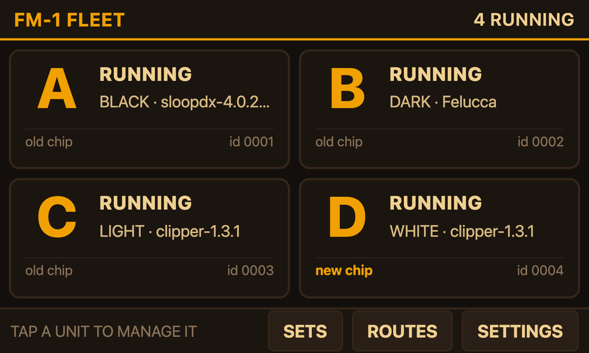
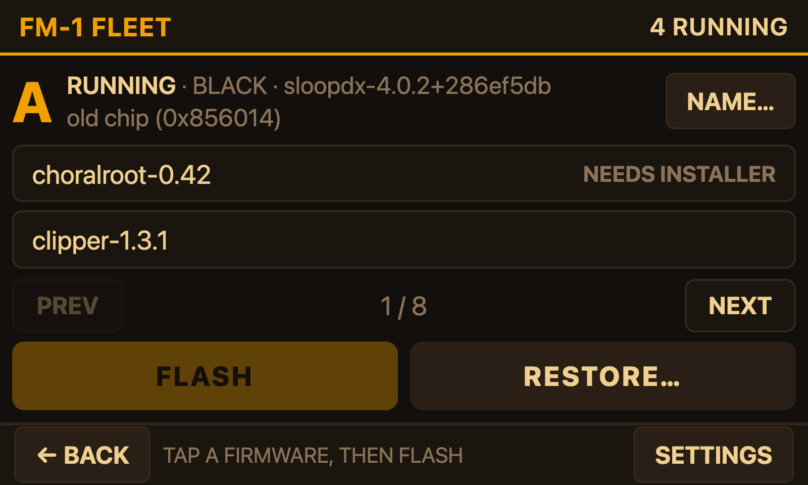
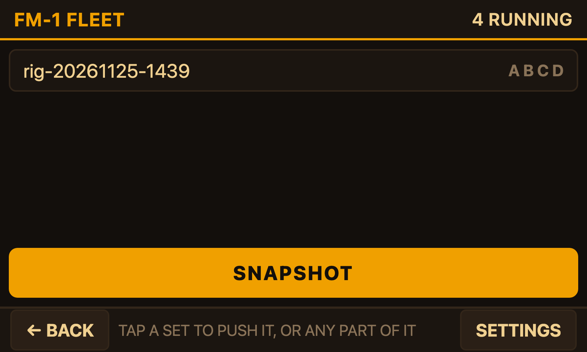
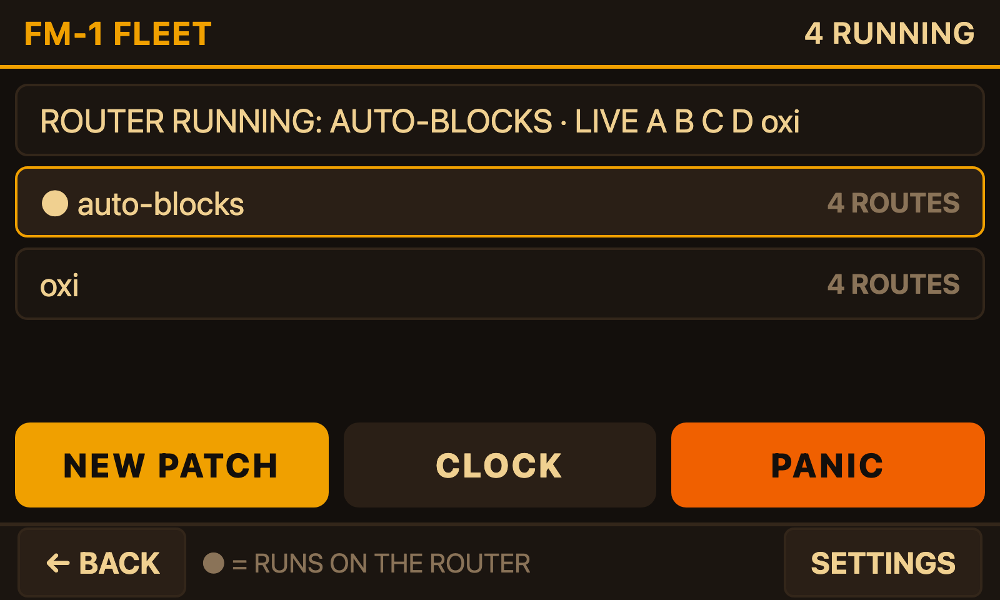
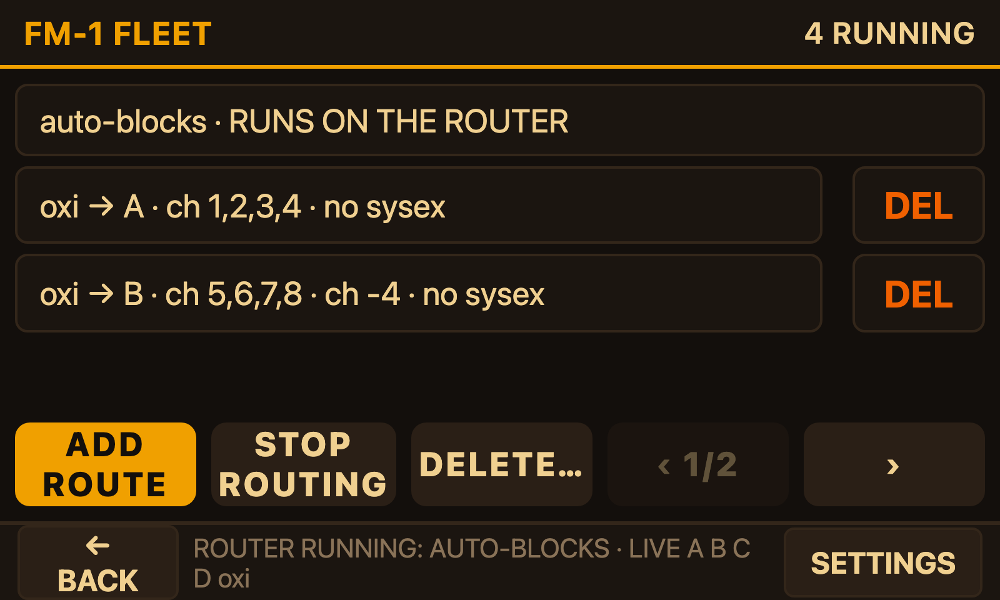
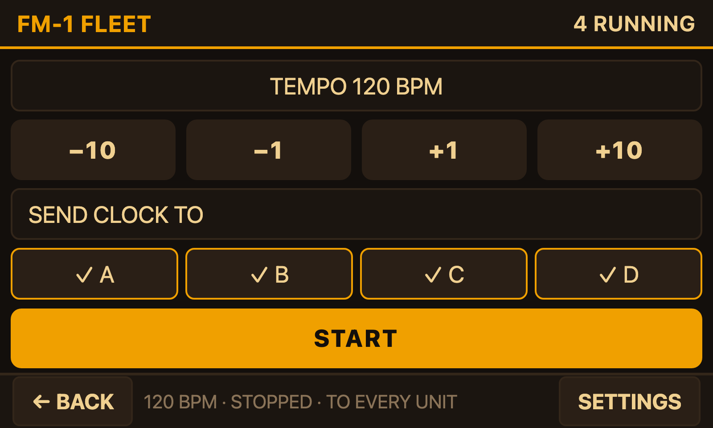
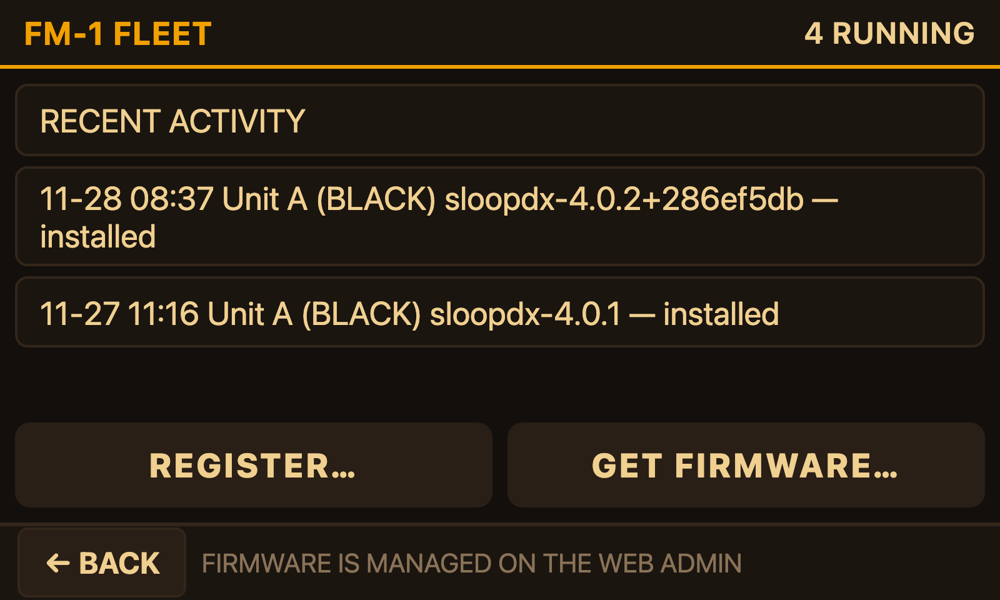
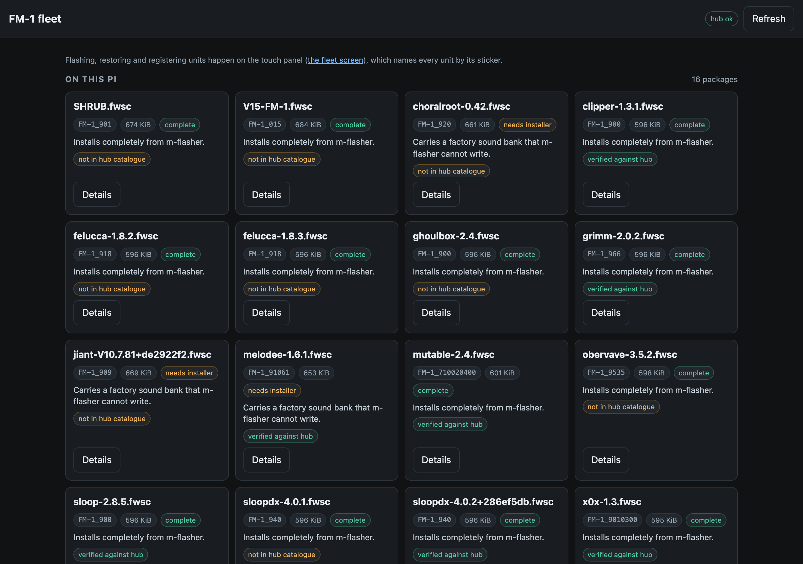
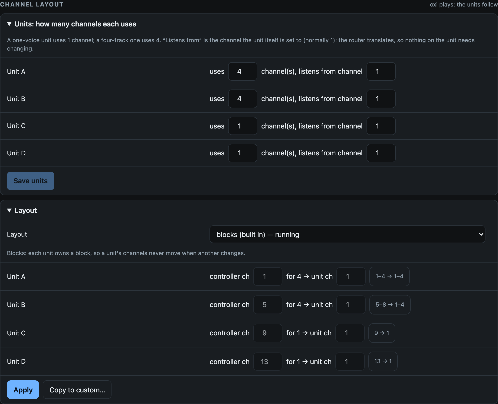
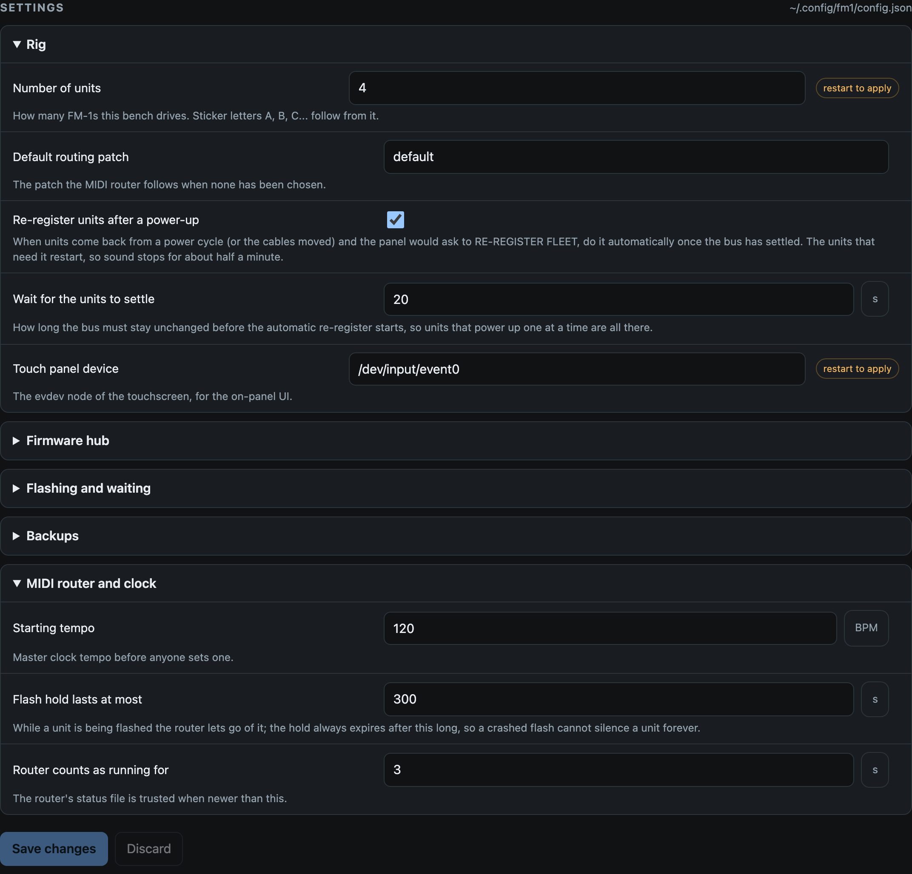

# A tour of the screens

The Pi serves two web UIs from the same server:

- the **touch UI**, designed for an 800×480 panel and served unchanged to a phone or tablet, is
  where you flash, back up, register, route and set the clock;
- the **admin page** (`/index.html`) is a denser page for what is awkward on a touch screen: the
  firmware library and hub, channel layouts, and every setting.

Screenshots below are from a real bench (four FM-1s and an Oxi One on a Raspberry Pi 3B+). Unit ids
are shown as `0001` to `0004`, not the real ones.

## The touch UI

### Fleet

One tile per unit. The big letter is the unit's sticker (A, B, ...); a `~` after it means the unit
was placed by USB port only, not by a readable id. Each tile shows the state (`RUNNING`,
`READY TO FLASH` in download mode, `NOT CONNECTED`), the unit's name and firmware, the flash chip
generation, and the last four characters of its flash id. The corner counts running units.

Tap a tile to manage that unit. **SETS**, **ROUTES** and **SETTINGS** are at the bottom.

If letters show `NOT CONNECTED` while the same units show as `?`, a **FLEET NOT REGISTERED** bar
appears above the tiles. After a power-up the Pi fixes this by itself; see
[GUIDE-registering-units.md](GUIDE-registering-units.md).

### One unit

The header repeats the unit's letter, state, name, firmware and chip. Below it is the firmware library
on the Pi, a page at a time. `NEEDS INSTALLER` marks a firmware that carries a factory sound bank the
flasher cannot write; the maker's own installer finishes it. Tap a firmware, then **FLASH**. A write
takes two deliberate taps and the second one names the unit; the Pi backs the unit up first and checks
the flash id before it writes. **RESTORE...** puts a saved image back, and **NAME...** gives the unit
a name that follows its letter.

When a newer version of the firmware a unit is running is in the catalogue, the unit's tile shows an
`UPDATE` badge.

### Sets

A **set** is one firmware (or saved image) per unit, pushed in one go through the same backup-first
writers. **SNAPSHOT** records each unit's newest saved backup as a set, so the rig can be put back. Tap a set to push all
of it, or any part of it.

### Routes

The top line is the router's state: which patch it runs and which devices are live. The dot marks the
patch that runs on the router. **NEW PATCH** makes one, **CLOCK** opens the master clock, and
**PANIC** sends all-sound-off to every running unit. Patches made by a channel layout are called
`auto-<layout>` (see [GUIDE-midi-hub.md](GUIDE-midi-hub.md)).

### A patch

Each line is one route: where it comes from, where it goes, which channels pass, any channel shift
(`ch -4`) and what is blocked. **ADD ROUTE** adds one, **RUN THIS** / **STOP ROUTING** chooses whether
the router runs the patch, and **DELETE...** removes it.

### Clock

Set the tempo, tick the units that should follow it, and **START**. The router sends MIDI start, clock
and stop. A router always starts with the clock stopped.

### Settings

Recent activity from the audit log (every flash, restore and registration), **REGISTER...** for a unit
that has no letter yet, and **GET FIRMWARE...** to fetch from the catalogue. Everything else is on the
admin page.

## The admin page

Open `http://<pi>/index.html` (headless) or `http://<pi>:8080/index.html`. Changes made from another
machine need the write token; it is printed where the server starts and kept in `~/.config/fm1/token`.

### Library and hub

**On this Pi** lists the firmware packages in the library, each with what the flasher can do with it
(`complete`, or `needs installer`) and whether its checksum matches the hub's catalogue. **Browse the
hub** below it searches the catalogue and downloads a package, checked against its published checksum.

### Channel layout

Top: for each unit, how many channels it uses and which channel it listens from. Below: pick a layout,
see how the controller's channels map onto each unit, and **Apply** it. `blocks` and `packed` are
built in; **Copy to custom...** makes one you can edit. The router does the translation, so nothing on
the units changes. See [GUIDE-midi-hub.md](GUIDE-midi-hub.md).

### Settings

Every tunable lives here, in groups (the screenshot shows two open). A yes/no setting is a checkbox.
*Re-register units after a power-up* is the automatic version of RE-REGISTER FLEET, and *Wait for the
units to settle* sets how long the bus must be quiet first. A few settings say *restart to apply*;
a few, such as the flasher program, are shown but locked on purpose. Nothing is saved until you press
**Save changes**.
