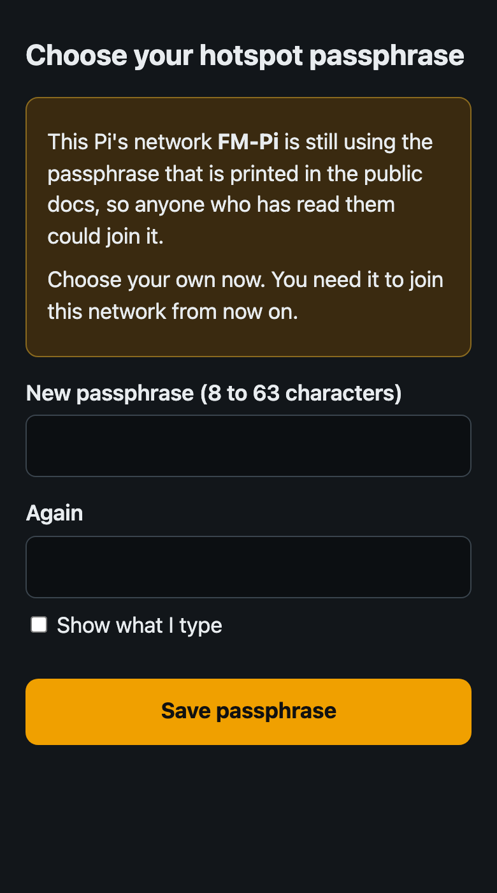
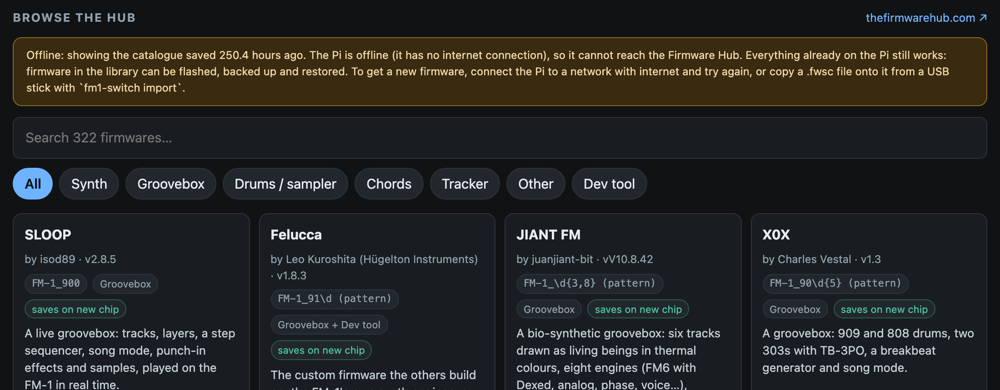
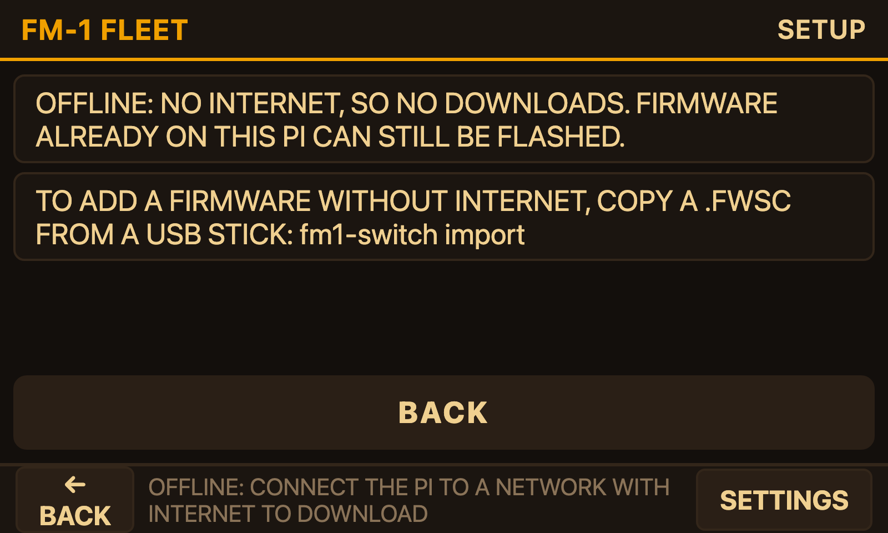
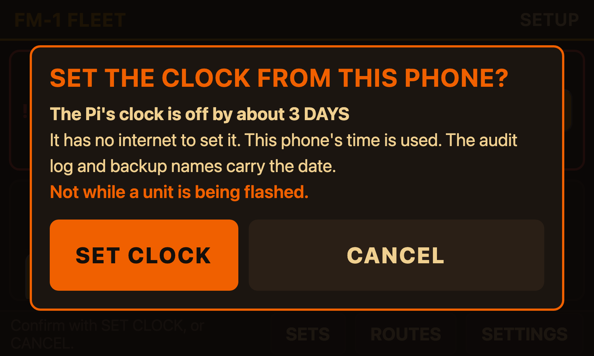

# The Pi's own WiFi hotspot

At home the Pi joins your WiFi and you open its touch UI from a phone on the same network. At a gig or a
rehearsal there is no known WiFi, so the phone cannot reach the Pi. With the fallback on, **when the Pi
cannot connect to any saved network, it makes its own WiFi network.** Join it from your phone and open the
same UI. No router, no internet.

> **Status.** Verified on a real Pi (2026-11-28): the hotspot comes up by itself when the WiFi is lost (from the
> `fm1-net` service), a phone joins and is never dropped while on it, the Pi returns when the phone leaves, and
> the first-use passphrase form works. Not yet exercised: a boot with no known network at all, and a reboot with
> the service enabled. Bench notes: [BENCH-wifi-fallback.md](BENCH-wifi-fallback.md). Design and open questions:
> [ROADMAP-field-network.md](ROADMAP-field-network.md).

## The name and the default passphrase

| | |
|---|---|
| Network name | **`FM-Pi`** |
| Default passphrase | **`g1gb0x-fm1`** |
| Address once joined | **`http://fm-pi.local/`** (or `http://10.42.0.1/` if your phone does not resolve `.local`) |

**The default passphrase is public: it is printed here, in a repository anyone can read.** Everyone who installs
this starts with the same one, so the Pi makes you replace it the first time you use the hotspot.



**What happens.** The hotspot comes up with the default, so a new rig works out of the box. The first time a phone
that joined it opens **any** page, it is taken to a form that asks you to choose your own passphrase. Until you do,
that phone can reach nothing else (pages go to the form, the API refuses). When you save, the network restarts in a
few seconds and the phone drops; join `FM-Pi` again with the **new** passphrase and open `http://fm-pi.local/`. The
Pi's own touch panel and phones on your house WiFi are never asked.

**The catch.** Until it is changed, anyone nearby who has read this page could join in that window and choose the
passphrase first. They could not flash, restore or change anything else (that needs the write token), but you
would find the hotspot locked and have to reset it at the Pi (`fm1-switch net passphrase --prompt`). The way to
avoid it is to **change the passphrase once, at home**, before you take the rig anywhere (below). You can also
choose how strict the Pi is:

| `net_default_passphrase` | What it does while the passphrase is still the default |
|---|---|
| `gate` (the default) | the hotspot works; the first phone to open a page must choose a passphrase |
| `refuse` | the hotspot will **not** come up until it is changed at the Pi |
| `allow` | no restriction: the default stands (a throwaway rig, a workshop with the password on the wall) |

`fm1-switch net status` says which one applies. Under `refuse`, `fm1-switch net up --yes --allow-default` allows
the default for one timed run. A phone that opens the form after the passphrase has been changed is told it is
already set.

## Change the passphrase (do this first, at home)

On the Pi:

```bash
fm1-switch net passphrase --prompt
```

You type the new passphrase twice (8 to 63 characters). It does not echo and does not land in your shell history.
The hotspot profile is updated at once. Other ways:

| Command | What it does |
|---|---|
| `fm1-switch net passphrase` | shows the current passphrase |
| `fm1-switch net passphrase --prompt` | sets one you type (recommended) |
| `fm1-switch net passphrase --random` | makes a random 12-character one and prints it |
| `fm1-switch net passphrase 'my phrase here'` | sets it from the command line (visible in your shell history) |
| `fm1-switch net passphrase --default` | goes back to the published default |

The passphrase lives in `~/fm1-hotspot.key` (readable only by you). It is never in the config file and never
shown on a web page.

**Phones that joined before:** a phone remembers the old passphrase. On the phone, *forget* the `FM-Pi` network
and join again with the new one. A wrong passphrase shows up on the Pi as `AP-STA-POSSIBLE-PSK-MISMATCH` in the
`wpa_supplicant` log, and on the phone as "wrong password" or a connection that never completes.

## Change the name, band or channel

These are settings (`~/.config/fm1/config.json`, or the Settings page): `net_ssid` (up to 32 letters, digits,
space, `.`, `_`, `-`), `net_band` (`2.4` or `5`) and `net_channel` (1 to 11 on 2.4 GHz; 36 to 48 or 149 to 165 on
5 GHz). Apply them to the hotspot profile with:

```bash
fm1-switch net setup
```

`2.4` is the default: it reaches furthest, and the units' own WiFi (fm1-radio) joins 2.4 GHz only. If several rigs
are in one room, give each its own name.

## Set it up

1. **Allow the Pi's user to run a hotspot without sudo** (once). NetworkManager refuses a protected hotspot from
   a service or an SSH session otherwise. Copy the rule from the repository and restart polkit:

   ```bash
   sudo cp ~/fm1/fm1-switch/polkit/50-fm1-wifi.rules /etc/polkit-1/rules.d/50-fm1-wifi.rules
   sudo systemctl restart polkit
   nmcli general permissions | grep -i "wifi.share.protected\|network-control\|settings.modify.system"
   ```

   All three should read `yes`. The rule only covers these three NetworkManager actions, for the `netdev` group.
2. **Make the hotspot profile** (nothing comes up, and no saved network is touched):

   ```bash
   fm1-switch net setup
   ```

3. **Change the passphrase** (above). `net setup` offers to do it for you when you run it at a terminal. If you
   skip this, the first phone to use the hotspot is asked instead.
4. **Try it by hand** before turning the fallback on. This raises the hotspot for two minutes, then puts your
   saved network back. Your SSH session will drop, so run it detached and read the log afterwards:

   ```bash
   nohup fm1-switch net up --yes --for 120 > ~/net-up.log 2>&1 &
   ```

   Join `FM-Pi` from a phone and open `http://fm-pi.local/`.
5. **Turn the fallback on:**

   ```bash
   cp ~/fm1/fm1-switch/systemd/fm1-net.service ~/.config/systemd/user/
   systemctl --user daemon-reload
   systemctl --user enable --now fm1-net
   ```

## What the fallback does

| Setting | Default | Meaning |
|---|---|---|
| `net_mode` | `auto` | `auto`: fall back to the hotspot when no saved network connects. `home`: never raise it. `field`: always run it. |
| `net_fallback_at_boot` | on | when no saved network connects after boot, raise the hotspot |
| `net_fallback_on_loss` | on | when a connected network goes away, raise the hotspot |
| `net_fallback_after` | 60 s | how long no saved network may be connected before the hotspot comes up |
| `net_retry_home_every` | 5 min | while the hotspot is up, look for a saved network again (0 = never); a failed try waits twice as long next time, up to an hour |
| `net_retry_only_when_empty` | on | switch back **only when no phone is joined**, so it never drops someone who is using it |
| `net_default_passphrase` | `gate` | what to do while the passphrase is the published default: `gate`, `refuse` or `allow` (above) |

"Saved networks" are the ones NetworkManager already has with auto-connect on. This feature **never creates,
changes or deletes a saved network**; it only brings the hotspot profile up and down.

## Using it

On the phone: Wi-Fi settings, `FM-Pi`, your passphrase, then `http://fm-pi.local/`. The phone may say there is
**no internet** on this network; that is true and expected. Stay connected. Android phones that cannot resolve
`.local` can use `http://10.42.0.1/`. Changes made from the phone need the write token, as from any other
machine (see [GUIDE-screens.md](GUIDE-screens.md)).

## Working without internet

On the hotspot the Pi has no internet behind it. Things that need the internet say so at once, in plain words,
instead of hanging, and everything else keeps working:

| | Offline |
|---|---|
| Flash, back up and restore a unit, SETS, routes, clock, layouts, registering | **work as normal** |
| Firmware already in the library on the Pi | **can be flashed** |
| The catalogue (the firmware list) | shows the copy saved the last time the Pi was online, marked **offline** with its age |
| `UPDATE` badges | come from that saved catalogue, so they can be out of date |
| Download a firmware | **refused straight away** with: *"The Pi is offline ... firmware in the library can be flashed ... connect the Pi to a network with internet and try again, or copy a .fwsc file onto it from a USB stick with `fm1-switch import`."* |





How you see it: the admin page's hub badge reads **offline** (instead of "hub ok"), the **Download** buttons are
greyed out, and a note says when the catalogue was saved. On the touch screen, **GET FIRMWARE** opens with
"OFFLINE: THIS PI HAS NO INTERNET, SO IT CANNOT DOWNLOAD. FIRMWARE ALREADY ON IT CAN STILL BE FLASHED." and
the list is greyed out. From the shell, `fm1-switch fetch ID` prints the same words and exits with an error.

The Pi decides it is offline when it has no default route, or when it cannot reach the hub within a few seconds
(checked at most every 30 seconds, and every 10 seconds while offline, so it notices as soon as the internet is
back). **Get what you need before you go:** download the firmware you might want while you are home, or copy
`.fwsc` files onto the Pi with `fm1-switch import` from a USB stick. A rig that should never call out can set
the environment variable `FM1_OFFLINE=1`.

The Pi's date is covered in [The clock](#the-clock-with-no-internet), below.

## The clock (with no internet)

The Pi has no battery-backed clock. While it is online, the network sets the time. Its normal time service also saves
the time regularly, so a Pi that stays powered keeps good time offline for days. The problem is a Pi that was
**switched off and then started offline** (at a gig): it wakes up believing it is still the moment it shut down.
The audit log, backup names and set names then carry the wrong date.

The Pi never hides this:

- `fm1-switch time status` says whether the clock is trusted: set by the network, or by a person since this boot.
- Audit-log lines written while it is **not** trusted carry `"clock": "unsynced"`, so you can tell later which dates to
  doubt.
- When the Pi's clock is untrusted **and your phone's time differs by more than two minutes**, the touch screen shows
  **PI CLOCK OFF BY 3 DAYS** with a **SET FROM THIS PHONE** button (and the admin page shows a note with a button).



Setting it uses the phone's time (a phone on a mobile network knows the right time even when the Pi's WiFi has no
internet). It is guarded:

- **Never over a clock the network set.** If the network has set the clock, it is not changed by hand.
- **Only a believable time:** not before 2026 or after 2100, and at least two minutes different from the Pi's.
- **Never during a write.** The router's holds and the flash lock expire on the clock, so it is not moved while a unit is
  being flashed or restored.
- The Pi **switches network time off for a moment, sets the time, and always switches network time back on**, so the
  network takes over as soon as there is internet again. The change (old time, new time) is written to the audit log.
- Setting it counts until the next reboot. After a reboot the Pi asks again, because the clock has reset.

From the shell (for a headless Pi): `fm1-switch time status` and `fm1-switch time set "2026-11-28 10:50"`.

**One-time permission.** Setting the clock needs a small extension of the same polkit rule the hotspot uses (two more
actions, for the `netdev` group). If you installed the rule earlier, install the new copy:

```bash
sudo cp ~/fm1/fm1-switch/polkit/50-fm1-wifi.rules /etc/polkit-1/rules.d/50-fm1-wifi.rules
sudo systemctl restart polkit
```

Without it, setting the clock says "the Pi's user is not allowed to set the time yet" and changes nothing.

## If something does not work

| Symptom | Try |
|---|---|
| Every page shows "Choose your hotspot passphrase" | that is the first-run form: choose a passphrase. It goes away once the passphrase is not the default |
| The phone says wrong password | forget `FM-Pi` on the phone and rejoin; check with `fm1-switch net passphrase`; look for `AP-STA-POSSIBLE-PSK-MISMATCH` in `journalctl -u wpa_supplicant` |
| `net setup` or `net up` fails with a permission error | `nmcli general permissions` must show `yes` for the three actions above |
| The hotspot never appears | `fm1-switch net status` (is `net_default_passphrase` `refuse` with the default still set?); is `fm1-net` running (`systemctl --user status fm1-net`)? is `net_mode` `home`? |
| The Pi will not leave the hotspot | a phone is still joined (`net_retry_only_when_empty`); turn its Wi-Fi off |
| The Pi is not on your WiFi and you cannot reach it | power-cycle it: the hotspot profile has auto-connect off, so it boots onto your saved WiFi |
